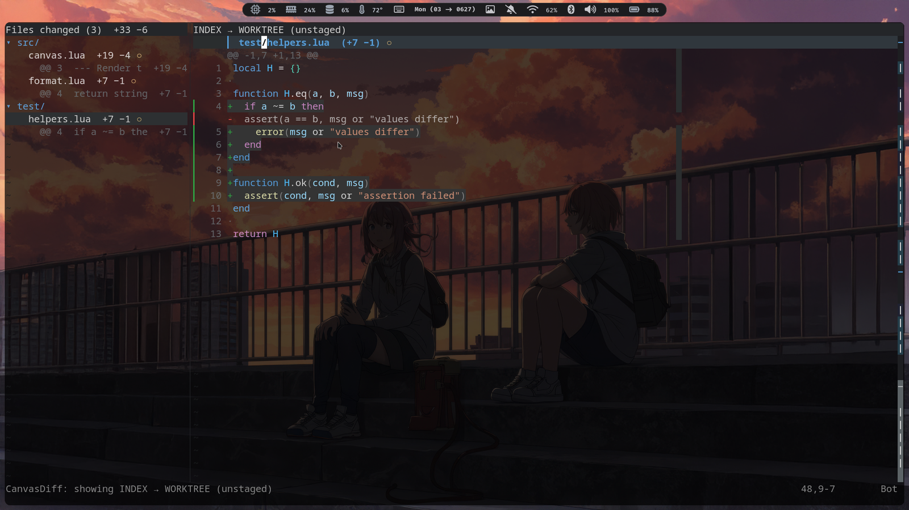
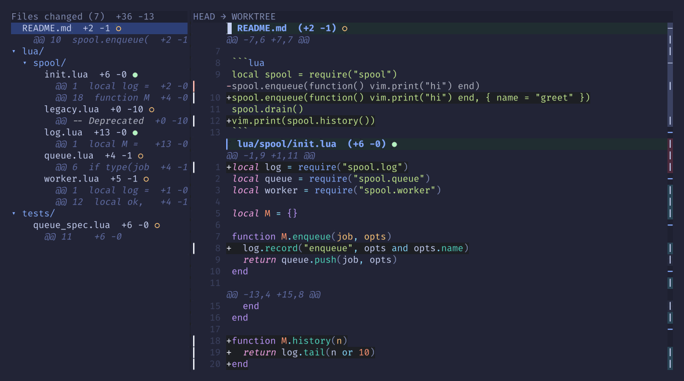
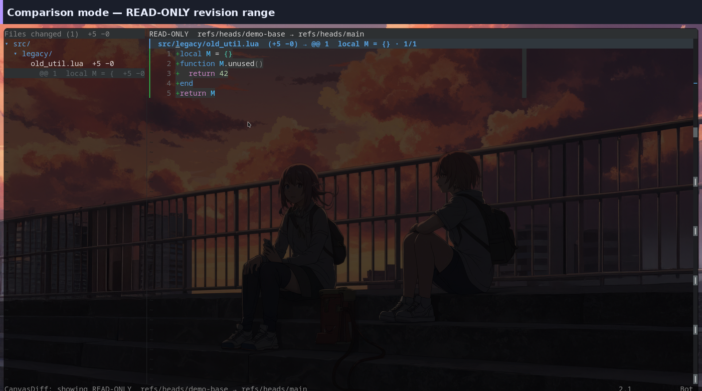
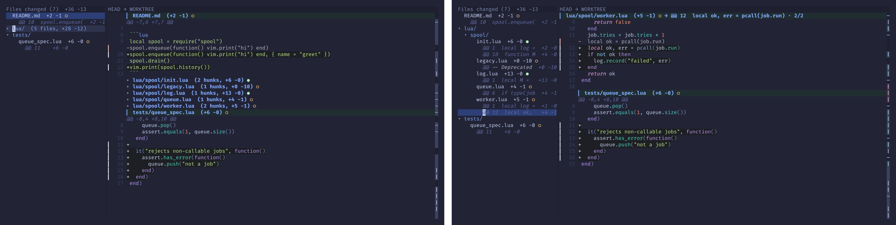
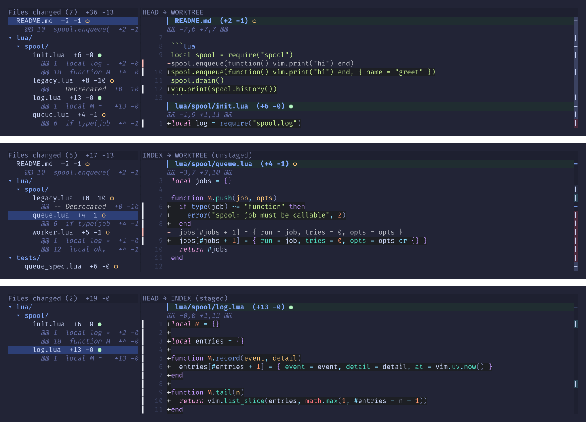
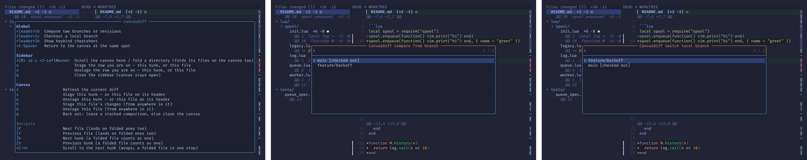

# canvasdiff.nvim

Your whole **Git Diff** (changeset) as one buffer you can work inside.

CanvasDiff renders every changed file into one scrollable canvas. Press Enter
on any line to open the real file with your LSP, Tree-sitter, autocmds, and
unsaved edits intact; edit it, then jump back to the line you are on.

CanvasDiff is **pre-alpha**. Its behavior is tested, but the public surface may
still change before the first stable release.



### Screenshots

**1. Live edit — the canvas is a workspace, not a viewer**
Enter opens the real file with your LSP, Tree-sitter, and unsaved edits
intact. Edit, save, jump back: the canvas already shows the new line.



**2. Comparison mode**
Read-only revision ranges without checking out branches.



**3. Sidebar fold & jump**
Left: `lua/` folded to one summary row, mirrored by the canvas. Right: Enter
on a hunk row jumps the canvas there, with the pinned crumb naming the spot.



**4. Lens states**
All · unstaged · staged — same review, different filters.



**5. Key menus**
Help cheatsheet and compare picker (shown with a `vim.ui.select` frontend;
plain Neovim uses a numbered prompt).



Screenshots are shot under `tokyonight-moon` by a deterministic rig; see
`media/shoot/run.sh` to regenerate them.

## Features

- **One real Neovim buffer for every changed file**, with Tree-sitter
  highlighting, native `/`, `y`, visual selection, and zero fake scratch
  overlays.
- **Exact bidirectional jumps** (`<CR>` / `<C-Space>`), line and column both
  ways, with your LSP, autocmds, and unsaved buffer edits intact.
- **Live review & AI-agent checkpoint loop**: live refresh on saves, focus
  changes, and external edits; persistent reviewed folds with stale-file `●`
  detection, `R` (mark reviewed & next), `zf` (unreviewed-only filter where
  stale files automatically resurface), winbar review progress, and `C`
  checkpoints (`CHECKPOINT → WORKTREE`) to isolate each agent/formatter pass.
- **Line, hunk, and file staging + undoable discard**: `s`/`u`/`x` act on the
  hunk under cursor, exact visually selected lines (`V` + `s`/`u`/`x`), or the
  whole file (`S`/`U`/`X`). Discards route through loaded buffers so `u` in
  the real file undoes them.
- **Ghost-deletion escape hatches**: `gy` yanks ghost deletions directly into
  `"`, `K` opens a floating word-diff peek with real `-`/`+` lines and
  symmetric intra-line highlighting, and `>`/`<` expand or shrink diff context
  inline per file.
- **Smart lazy auto-collapse**: lockfiles, `.gitattributes`
  `linguist-generated` / `-diff` files, and oversized diffs open collapsed and
  deferred without reading blobs or running diffs until you unfold them on
  demand.
- **Zero global keymap pollution**: CanvasDiff installs no process-wide
  mappings and never switches Git branches for you — bind `:CanvasDiff`
  commands or Lua API calls cleanly in your own config.

## Requirements

- Neovim 0.12 or newer. This is the tested and asserted floor.
- `git` on your `$PATH`.
- Linux is the development platform; macOS should work, and Windows is
  currently untested.

Tree-sitter parsers add syntax highlighting inside diff hunks but are optional.

## Installation

### lazy.nvim and LazyVim

CanvasDiff installs no process-wide global keymaps, so lazy-loading via `cmd`
and `keys` works cleanly out of the box with zero extra flags:

```lua
{
  "reklai/canvasdiff.nvim",
  cmd = "CanvasDiff",
  keys = {
    { "<leader>gd", "<cmd>CanvasDiff<cr>", desc = "CanvasDiff: toggle canvas" },
    { "<leader>gh", "<cmd>CanvasDiff here<cr>", desc = "CanvasDiff: open at current line" },
    { "<leader>gc", "<cmd>CanvasDiff checkpoint<cr>", desc = "CanvasDiff: checkpoint" },
    { "<leader>gb", "<cmd>CanvasDiff compare<cr>", desc = "CanvasDiff: compare branches" },
  },
  opts = {},
}
```

For [LazyVim](https://github.com/LazyVim/LazyVim), put the spec in
`lua/plugins/canvasdiff.lua`. Nested `opts` merge with any parent spec and are
passed to `require("canvasdiff").setup()`:

```lua
-- LazyVim: lua/plugins/canvasdiff.lua
return {
  {
    "reklai/canvasdiff.nvim",
    cmd = "CanvasDiff",
    keys = {
      { "<leader>gd", "<cmd>CanvasDiff<cr>", desc = "CanvasDiff: toggle canvas" },
    },
    opts = {
      sidebar = { width = 40 },
      highlights = {
        CanvasDiffFileBar = { fg = "#c6d0f5", bg = "#303446" },
      },
    },
  },
}
```

After installing, run `:checkhealth canvasdiff`. It checks Neovim and Git and
audits the setup table for misspelled, removed, or invalid options.

## Quick start

1. Run `:CanvasDiff` inside a Git worktree.
2. Move through the canvas with normal motions, `]h`/`[h` for hunks, and
   `]f`/`[f` for files.
3. Press `<CR>` to open the real file at the exact line & column; edit, then
   press `<C-Space>` to return on the line you are on.
4. Press `s`/`u`/`x` to stage, unstage, or undoably discard a hunk — or
   visually select lines (`V`) first for exact line-level staging/discarding.
5. Press `K` on a hunk for a word-diff peek with real `-`/`+` lines, `gy` to
   yank deleted ghost lines, and `>`/`<` to expand or shrink file context.
6. Press `R` to mark a file reviewed and jump to the next unreviewed or stale
   file, `zf` to filter to unreviewed files only, and `C` to checkpoint before
   an agent or formatter pass.
7. Press `<Tab>` to cycle `all → unstaged → staged`, and `q` to close.

## Configuration recipes

### Change one behavior

Pass only what you want to change; omitted values keep their defaults:

```lua
require("canvasdiff").setup({
  context = 5,
  sidebar = { width = 40 },
  scrollbar = { enabled = false },
})
```

### Change appearance

`highlights` maps exact `CanvasDiff*` group names to native Neovim highlight
specifications. Use `fg`, `bg`, `sp`, `link`, `blend`, `bold`, `italic`,
`undercurl`, and any other field supported by `nvim_set_hl()`. CanvasDiff does
not add a theme or palette vocabulary.

```lua
require("canvasdiff").setup({
  highlights = {
    CanvasDiffFileBar = {
      fg = "#c6d0f5",
      bg = "#303446",
      bold = true,
    },
    CanvasDiffGhost = { link = "Comment" },
  },
})
```

The default palette is deliberately quiet: added and changed rows carry a
neutral elevation derived from your colorscheme, and the green/red lives only
on the `+`/`-` prefix and the gutter, so syntax highlighting stays readable
inside hunks. `profile` selects a different default vocabulary for the diff
rows — colors only, element toggles are independent:

```lua
require("canvasdiff").setup({
  profile = "classic", -- "quiet" (default) | "classic" | "mono"
})
```

- `quiet` — neutral row elevation; hue only on the prefix and gutter.
- `classic` — traditional `DiffAdd`/`DiffDelete` row washes.
- `mono` — no hue anywhere: elevation, dimming, and `+`/`-` shapes carry
  everything (colorblind-safe, monochrome-terminal-safe).

Explicit `highlights` overrides win over any profile, so the equivalent of
`classic` can also be rolled by hand — or partially, for one group:

```lua
require("canvasdiff").setup({
  highlights = {
    CanvasDiffAdd = { link = "DiffAdd" },
    CanvasDiffDel = { link = "DiffDelete" },
    CanvasDiffGhost = { link = "DiffDelete" },
  },
})
```

Each value is a complete highlight definition: like `nvim_set_hl()`, applying
it replaces that group's definition rather than filling fields from the old
one. Do not omit `fg`, `bg`, or attributes you intend the resulting group to
retain.

Ownership precedence, from lowest to highest, is:

```text
CanvasDiff defaults -> colorscheme/direct definition -> setup().highlights
```

CanvasDiff's derived and linked groups are defaults, so a colorscheme may own
any group and a direct definition may take ownership afterward. Explicit
`setup().highlights` values win over both. Reload order is separate from
ownership precedence: one process-wide `ColorScheme` callback asks CanvasDiff
to reapply its defaults after a scheme reload (those defaults still yield to
the scheme), then reapplies explicit overrides. Repeated setup calls replace
that state instead of accumulating callbacks.

To release an explicit override, omit it from a later `setup()` call or set it
to `false`:

```lua
require("canvasdiff").setup({
  highlights = { CanvasDiffFileBar = false },
})
```

If you author a colorscheme, define the complete group directly and do not
also configure an explicit override for that group. CanvasDiff's defaults yield
to this definition, and later setup resets preserve a direct definition the
manager does not own:

```lua
vim.api.nvim_set_hl(0, "CanvasDiffFileBar", {
  fg = "#c6d0f5",
  bg = "#303446",
})
```

### Replace or disable keys

Every action accepts one key or a list. An override replaces the default list;
`false`, `""`, or `{}` disables the action.

```lua
require("canvasdiff").setup({
  keymaps = {
    canvas = {
      collapse = "za", -- replaces { "za", "c" }
      close = "Q",
    },
    sidebar = { help = false },
    file = { back = "<C-g>" },
  },
})
```

## Complete configuration reference

Defaults are shown below. `highlights` is replacement-from-defaults on each
setup call; ordinary option tables deep-merge with these defaults.

```lua
require("canvasdiff").setup({
  context = 3,
  base = "HEAD",
  profile = "quiet",
  highlights = {},

  keymaps = {
    canvas = {
      jump = { "<CR>", "<2-LeftMouse>" },
      collapse = { "za", "c" },
      review_next = "R",
      filter_unreviewed = "zf",
      expand_context = ">",
      shrink_context = "<",
      yank_deleted = "gy",
      peek_hunk = "K",
      next_file = "]f",
      prev_file = "[f",
      next_hunk = "]h",
      prev_hunk = "[h",
      cycle_next = "<C-n>",
      cycle_prev = "<C-p>",
      refresh = "r",
      stage = "s",
      unstage = "u",
      stage_file = "S",
      unstage_file = "U",
      discard = "x",
      discard_file = "X",
      lens_next = "<Tab>",
      lens_prev = "<S-Tab>",
      checkpoint = "C",
      sidebar = "o",
      close = "q",
      help = "<leader>lh",
    },
    sidebar = {
      select = { "<CR>", "za", "c", "<2-LeftMouse>" },
      stage = "s",
      unstage = "u",
      close = "q",
      help = "<leader>lh",
    },
    file = { back = "<C-Space>" },
  },

  sidebar = { enabled = true, width = 32 },
  highlight = { enabled = true, margin = 100, debounce_ms = 30 },
  watch = { enabled = true, debounce_ms = 200, poll_ms = 3000 },
  scrollbar = { enabled = true },
  statuscolumn = { enabled = true },
  virt = {
    enabled = true,
    max_files = 200,
    max_lines = 100000,
    margin = 100,
    max_expanded = 20,
  },
  auto_collapse = {
    enabled = true,
    max_lines = 500,
    max_bytes = 262144,
    patterns = {
      "*lock*", "*.lock", "*.min.js", "*.min.css",
      "*.map", "*.pb.go", "*_pb2.py", "*.snap",
    },
    gitattributes = true,
  },
  session = { enabled = true },

  -- Or use glyphs = "ascii".
  glyphs = {
    ctx = " ", del = "-", add = "+",
    file = "▎", folded = "▸", open = "▾", minus = "−",
    gutter = "▎",
    staged = "●", unstaged = "○", stale = " ●",
    crumb = " → ", crumb_sep = " · ",
    scroll_file = "‒", scroll_bar = "❘",
  },
})
```

`context` controls diff context. `base` selects the initial worktree
comparison. `profile` selects the diff-row color vocabulary; unknown names are
diagnosed and fall back to quiet. `highlight` controls Tree-sitter syntax
work; `watch` controls live reconciliation. `auto_collapse` keeps generated
files, lockfiles, `.gitattributes` `linguist-generated`/`-diff` paths, and
oversized diffs collapsed and deferred until unfolded on demand; `virt`
auto-collapses distant sections once either threshold is exceeded. `sidebar`,
`scrollbar`, `statuscolumn`, and `session` independently enable their named
features. `glyphs = "ascii"` selects a single-cell ASCII set.

### Highlight groups

All 29 public groups are stable customization points:

| Group | Default and use |
| --- | --- |
| `CanvasDiffAdd` | Derived neutral elevation for added rows. |
| `CanvasDiffDel` | Elevated background plus dimmed foreground for real deletion rows. |
| `CanvasDiffGhost` | Dimmed foreground for ghost deletion lines. |
| `CanvasDiffWordAdd` | Derived intra-line word emphasis for added tokens in hunk peek. |
| `CanvasDiffWordDel` | Derived intra-line word emphasis for deleted tokens in hunk peek. |
| `CanvasDiffPrefixAdd` | Derived add foreground for the `+` prefix. |
| `CanvasDiffPrefixDel` | Derived delete foreground for the `-` prefix. |
| `CanvasDiffGutterAdd` | Derived add foreground in the status column. |
| `CanvasDiffGutterDel` | Derived delete foreground in the status column. |
| `CanvasDiffFileBar` | Derived file-bar background, tinted toward `Directory`. |
| `CanvasDiffFileHeader` | Links to `Title`; filename on a file bar. |
| `CanvasDiffHunkHeader` | Links to `Comment`; hunk header rows. |
| `CanvasDiffBinary` | Links to `Comment`; binary-file notices. |
| `CanvasDiffWinbar` | Links to `WinBar`; editable comparison band. |
| `CanvasDiffWinbarReadOnly` | Links to `Visual`; read-only comparison band. |
| `CanvasDiffStaged` | Links to `Added`; staged marker. |
| `CanvasDiffUnstaged` | Links to `DiagnosticWarn`; unstaged marker. |
| `CanvasDiffStale` | Links to `DiagnosticError`; stale marker. |
| `CanvasDiffStaleEmphasis` | Bold emphasis layered on the stale marker. |
| `CanvasDiffSidebarDir` | Links to `Directory`; sidebar directories. |
| `CanvasDiffSidebarActive` | Links to `Visual`; active sidebar row. |
| `CanvasDiffSidebarHunk` | Links to `Comment`; sidebar hunk row. |
| `CanvasDiffHunkDel` | Links to `CanvasDiffGhost`; labels taken from deleted lines. |
| `CanvasDiffCrumb` | Empty by default; ordinary breadcrumb text on the file bar. |
| `CanvasDiffScrollFile` | Links to `Title`; minimap file boundary. |
| `CanvasDiffScrollAdd` | Links to `DiffAdd`; minimap additions. |
| `CanvasDiffScrollDel` | Links to `DiffDelete`; minimap deletions. |
| `CanvasDiffScrollChanged` | Links to `DiffChange`; minimap changed region. |
| `CanvasDiffScrollThumb` | Links to `PmenuThumb`; minimap viewport thumb. |

## Usage

### Canvas, sidebar, and folds

Each file starts with a tinted header and unified-diff-style hunks. Deleted
lines appear as dimmed ghost rows above the real row that replaced them, so a
worktree-backed row still maps exactly to a file line. The sidebar shows
directories, files, and hunk rows; selecting one scrolls the canvas there.

Press `c` or `za` to fold a file on the canvas or a directory in the sidebar.
Both views share the same fold state, and folds persist per repository. The
pinned header names the file and current hunk while the minimap shows file and
change density across the review.

### Staging and lenses

`s` and `u` stage or unstage the hunk under the cursor. On a file header,
folded placeholder, or sidebar file row they operate on the whole file; `S`
and `U` always take the whole file. Staging is refused when a modified loaded
buffer aliases the path, so unsaved text is never silently replaced.

Tab and Shift+Tab cycle these lenses:

| Lens | Old side | New side |
| --- | --- | --- |
| `all` | `HEAD` | worktree |
| `unstaged` | index | worktree |
| `staged` | `HEAD` | index |

Committed ranges such as `main..topic` and `main...topic` are read-only.

### Discarding

`x` puts the index's lines back into the worktree for the hunk under the
cursor: the reject to `s`'s accept, and the only canvas key that writes your
files. On a file header it takes the whole file, as `X` does from anywhere in
it; the whole-file form asks first.

It means what `git restore` means, so it works in the `unstaged` lens, and in
the `all` lens for a file with nothing staged. Anywhere the hunk on screen is
not exactly an unstaged change it declines and says which lens to use.

The write goes through the file's buffer when it is loaded, as one undoable
change: `u` in the file brings the hunk back. The lines it removed also go to
the unnamed register, as with any `x`.

### Checkpoints: what changed since I last looked

`C` marks everything on the canvas as seen and switches to the
`CHECKPOINT → WORKTREE` lens, which is empty until something changes. When an
agent, a formatter, or a rebase rewrites files between two passes, the second
pass shows only the delta. `C` again moves the checkpoint forward; Tab returns
to the full review; `:CanvasDiff since` comes back to the delta.

A checkpoint records the worktree as the review shows it, untracked files and
unsaved buffers included. It never writes your index, worktree, or branches:
it is a commit under the private per-worktree ref
`refs/worktree/canvasdiff/checkpoint` (visible to `git log --all`, removable
with `git update-ref -d`).

### From a file to the review

The jump runs both ways. `:CanvasDiff here` shows the review at the file line
under the cursor, opening it if needed, and Ctrl+Space keeps working after you
leave the file you jumped into: it follows you into other files in that
window. `:CanvasDiff quickfix` lists every hunk at its file line, so `:cnext`
steps through them across files without returning to the canvas.

### Commands

```vim
:CanvasDiff
:CanvasDiff open
:CanvasDiff close
:CanvasDiff toggle
:CanvasDiff here
:CanvasDiff refresh
:CanvasDiff sidebar
:CanvasDiff quickfix
:CanvasDiff compare
:CanvasDiff all
:CanvasDiff unstaged
:CanvasDiff staged
:CanvasDiff checkpoint
:CanvasDiff since
:CanvasDiff unreviewed
:CanvasDiff main..topic
:CanvasDiff main...topic
```

The empty command toggles the canvas. Commands complete with Tab.

### Default mappings

| Context | Keys | Action |
| --- | --- | --- |
| Canvas | `<CR>`, double-click | Open the selected real file line. |
| Canvas | `]f`/`[f`, `]h`/`[h` | Next/previous file or hunk; accepts a count. |
| Canvas | Ctrl+N/Ctrl+P | Cycle hunks with wrapping. |
| Canvas | `za`/`c`, `R`, `zf` | Fold; mark reviewed & next; toggle unreviewed-only filter. |
| Canvas | `>`/`<`, `K`, `gy` | Expand/shrink file context; word-diff hunk peek; yank deleted lines. |
| Canvas | Tab/Shift+Tab, `o` | Cycle lens; toggle sidebar. |
| Canvas | `r`, `s`/`u`, `S`/`U` | Refresh; stage/unstage hunk, visual line selection, or whole file. |
| Canvas | `x`, `X` | Discard unstaged hunk/visual lines; discard whole file (asks). |
| Canvas | `C` | Checkpoint: mark all seen, show only what changes next. |
| Canvas | `q`, `<leader>lh` | Close/back out; show the cheatsheet. |
| Sidebar | Enter/`za`/`c`/double-click | Select a file/hunk or fold a directory. |
| Sidebar | `s`/`u`, `q`, `<leader>lh` | Stage/unstage; close sidebar; show help. |
| Real file | Ctrl+Space | Return to the canvas, on the line you are on. |

### Sessions and large reviews

CanvasDiff stores the lens, folds, and content-based position per repository
under `stdpath("state") .. "/canvasdiff/"`. Disable this with
`session = { enabled = false }`.

Large reviews stay real Neovim buffers throughout: `auto_collapse` keeps
lockfiles, generated files, and oversized diffs deferred as 1-row placeholders
until unfolded on demand, `virt` collapses distant sections on huge changesets,
and interactive opens/pivots build in time slices so the editor stays responsive.

## Troubleshooting

- Run `:checkhealth canvasdiff` first. It reports version/Git failures,
  unknown or removed options, and invalid highlight specifications.
- Also read load/setup notifications for unknown glyph names or invalid glyph
  values.
- If nothing opens, confirm the current window is inside a Git worktree.
- If Ctrl+Space does nothing, your terminal may not transmit it; replace
  `keymaps.file.back`.
- Missing syntax usually means no Tree-sitter parser exists for that filetype.
- If another scrollbar draws at the right edge, disable either it or
  `scrollbar.enabled`.

## Documentation

- `:h canvasdiff` — searchable commands, mappings, configuration, highlights,
  troubleshooting, and Lua API.
- [docs/design.md](docs/design.md) — behavior and visual design rationale.
- [docs/architecture.md](docs/architecture.md) — module boundaries, state
  ownership, contributor workflow, and verification requirements.

## Contributing

See [docs/architecture.md](docs/architecture.md). Focused and full checks
include:

```sh
make unit
make architecture
NVIM_LOG_FILE=/tmp/canvasdiff.log make test
```

## License

[MIT](LICENSE)
